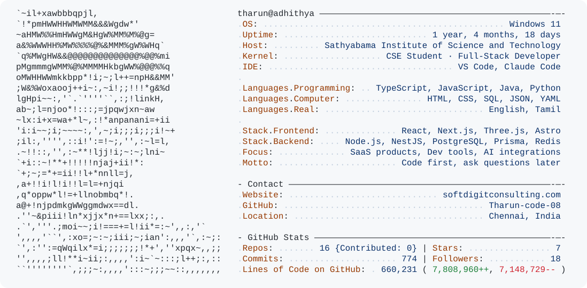

<!-- Profile README for Tharun-code-08. The card is rendered by today.py (see .github/workflows/build.yaml). -->

<a href="https://github.com/Tharun-code-08">
  <picture>
    <source media="(prefers-color-scheme: dark)" srcset="dark_mode.svg">
    
  </picture>
</a>

## Currently Building

- **[SoftdigitIMS](https://github.com/Tharun-code-08/Inventory-control)**: a multi-tenant inventory and ERP platform, running in production at [softdigitconsulting.com](https://softdigitconsulting.com/).
- **[Captik Clipper](https://github.com/Tharun-code-08/Clipper)**: turns one long video into captioned vertical shorts, with Claude picking the best moments.
- **[THARUN OS](https://github.com/Tharun-code-08/tharun-os-portfolio)**: my portfolio, a 3D island you walk around.

## Featured Projects

<table>
  <tr>
    <td width="50%" valign="top">
      <h3><a href="https://github.com/Tharun-code-08/Inventory-control">SoftdigitIMS</a></h3>
      Inventory and ERP platform for retail shops: procurement, a stock ledger with batches, expiry and FEFO, sales, invoices, analytics and background jobs, with strict per-shop isolation. Web, API and a warehouse mobile app in one monorepo.
        
      <code>NestJS</code> <code>React</code> <code>Expo</code> <code>PostgreSQL</code> <code>Prisma</code> <code>Redis</code> <code>BullMQ</code>
        
      <a href="https://softdigitconsulting.com/">Live site</a>
    </td>
    <td width="50%" valign="top">
      <h3><a href="https://github.com/Tharun-code-08/Clipper">Captik Clipper</a></h3>
      Paste a YouTube, Instagram or Drive link and get up to ten 9:16 shorts back. It transcribes code-mixed speech, has Claude pick and style the clips, scores each for virality, and lets you trim and restyle them in a clip studio before exporting.
        
      <code>Node.js</code> <code>React</code> <code>Remotion</code> <code>ffmpeg</code> <code>Python</code> <code>Claude API</code>
    </td>
  </tr>
  <tr>
    <td width="50%" valign="top">
      <h3><a href="https://github.com/Tharun-code-08/tharun-os-portfolio">THARUN OS</a></h3>
      A playable portfolio: walk a floating island where each building is a section, then boot a desktop-style OS from a CRT. Recruiters are one key away from a plain, printable résumé.
        
      <code>Next.js</code> <code>React Three Fiber</code> <code>Rapier</code> <code>Blender</code> <code>Web Audio</code>
    </td>
    <td width="50%" valign="top">
      <h3><a href="https://github.com/Tharun-code-08/MY-IDLE">Mini Playground</a></h3>
      A zero-install coding environment in the browser for 10+ languages: live previews for HTML, React, Vue and Svelte, plus Python, SQL, C/C++ and Java running through WebAssembly and compiler APIs.
        
      <code>React</code> <code>CodeMirror</code> <code>Pyodide</code> <code>sql.js</code> <code>Vite</code>
    </td>
  </tr>
</table>

**Also built:** [Library Management System](https://github.com/Tharun-code-08/LibraryManagementSystem) (Java 21, JavaFX, Hibernate, Flyway) · [SoftDigits Consulting site](https://soft-digits-consulting.vercel.app) (Next.js) · [Hilook Interiors](https://hilook-interiors.vercel.app) (client website)

## Tech I Work With

  

## GitHub Overview

  
  

  

---

**Build. Ship. Learn. Repeat.**

[softdigitconsulting.com](https://softdigitconsulting.com/) · [All repositories](https://github.com/Tharun-code-08?tab=repositories)

